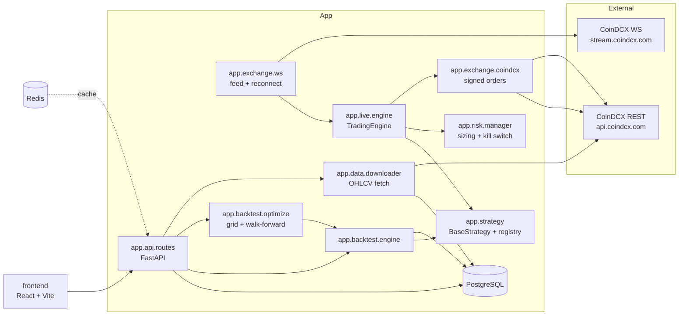
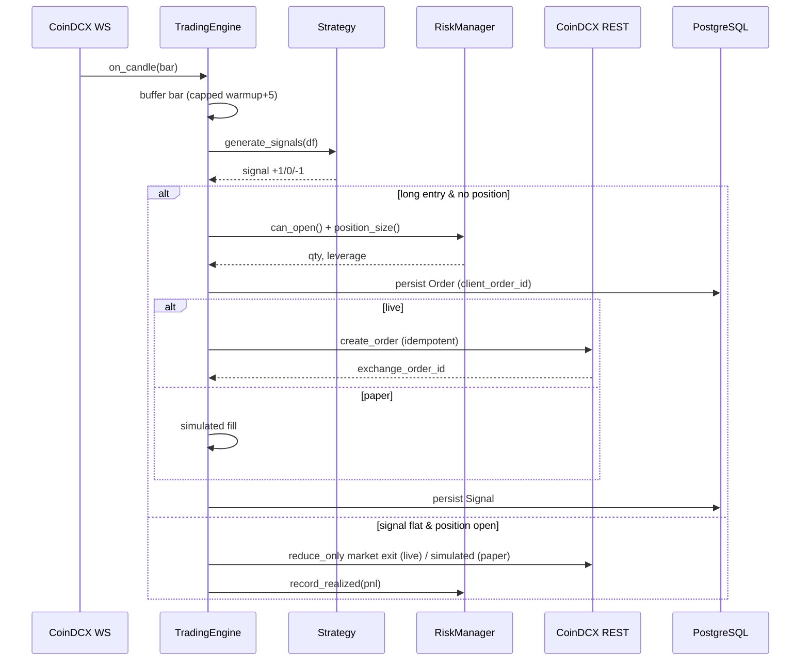
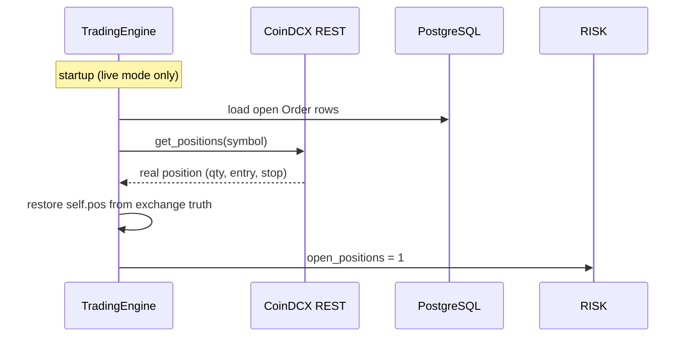
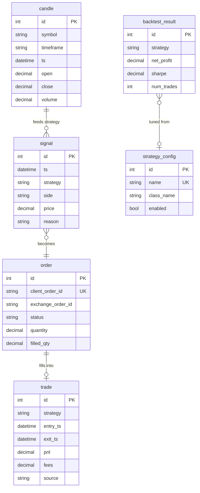
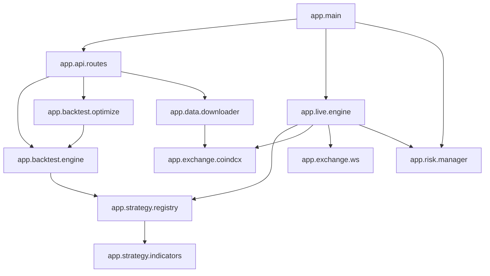

# Architecture

Mermaid diagrams. Rendered by GitHub. Text arch also in `../README.md`.

## System context

## Signal flow (live / paper)

## Crash recovery (reconcile)

## Data model

## Module dependency

